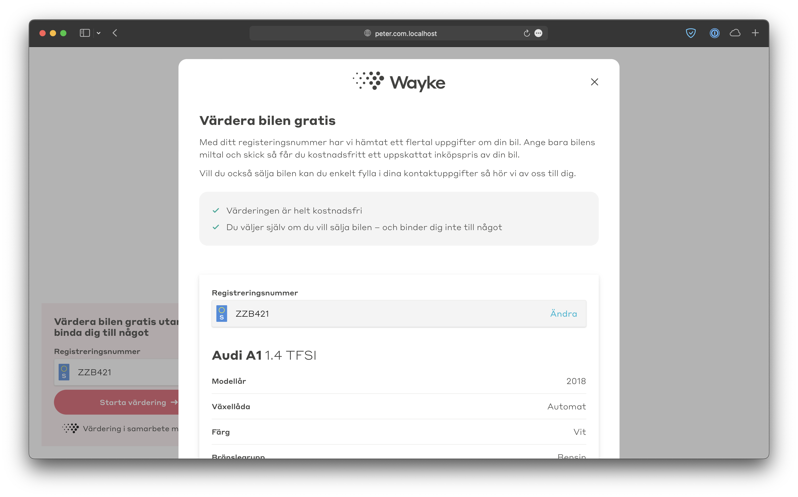

# Wayke EV Web

Repository for Wayke EV Web.



## Getting started

### Before you start

Install dependencies.

```bash
  npm install
```

### Local development

Run the following command to start a local development server.

```bash
  npm run start
```

The command above will start a local server on http://localhost:5000. Contact Wayke in order to get your origin white listed in order to interact with the API. For example, if http://my-custom-origin:5000 is white listed, update your local host file so that http://my-custom-origin points to 127.0.0.1.

## Deploy
Pushing to main or test will build, publish to cdn and publish to npm.

### main
Before merging to `main` update the version in package.json. If same version allready exist on npm then the operation is aborted. npm version will be tagged as `latest`.

| Files | Url |
| ------|:-------------:|
| js    | https://cdn.wayke.se/public-assets/wayke-ev-web/1.0.0/index.js |
| css   | https://cdn.wayke.se/public-assets/wayke-ev-web/1.0.0/index.css |

### test
Before merging to `test` update the version in package.json. Optionally add a postfix like `1.1.1-alpha-1` in order to easier to distinguish that it's not ready for production. If same version allready exist on npm then the operation is aborted. Npm version will be tagged as `next`.

| Files | Url |
| ------|:-------------:|
| js    | https://test-cdn.wayketech.se/public-assets/wayke-ev-web/1.0.0-alpha-1/index.js |
| css   | https://test-cdn.wayketech.se/public-assets/wayke-ev-web/1.0.0-alpha-1/index.css |

## Component Library

This repository uses [Clip UI](https://github.com/ourstudio-se/clip-ui) to display all front-end components available. To start _Clip UI_ run the following command.

```bash
  npm run clip
```

_Clip UI_ will start a local server on http://localhost:8000.

> The CSS and font files will be bundled upon start. If changes are made to these files, you will have to restart _Clip UI_ for the changes to take place.

## Working with HTML and CSS in this repository

The CSS in this repository is built using _SCSS_ and are based on a slighlty modified [launchpad-scss](https://github.com/alexerlandsson/launchpad-scss) boilerplate.

### CSS specificity

All CSS class names are prefixed using the namespace `.waykeev-*`. This will prevent this widget to overwrite any CSS applied to the website on which it is implemented on. However, we can not guarantee other CSS files won't overwrite the CSS in _Wayke EV_. This is due to it is impossible to protect against element selectors.

Reset styles and other necessary CSS targeting elements are selected using a nested selector based of the root element (`.waykeev-root`) placed inside a `:where()` to prevent higher specificity than class name selectors.

### Headings

To prevent multiple `h1` on your website, _Wayke EV_ does not include a `h1` as root heading level. Instead the headings starts from `h2`.